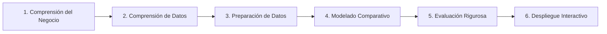
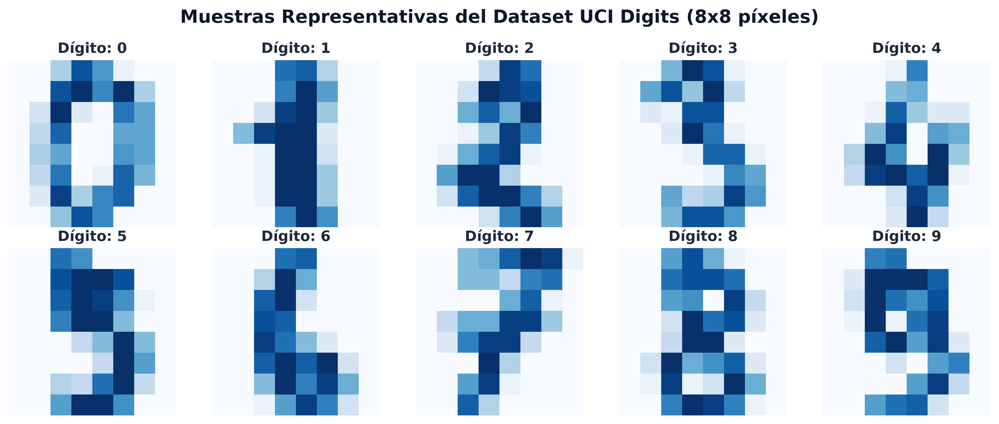
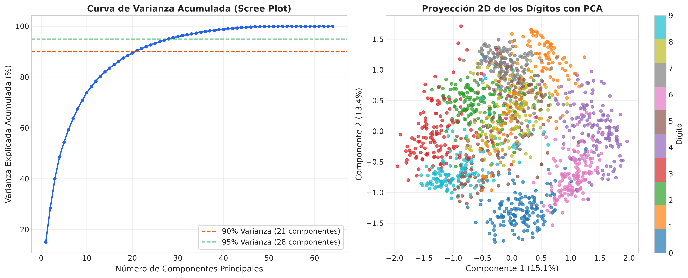
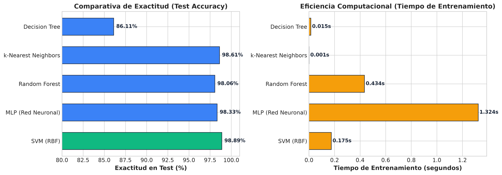
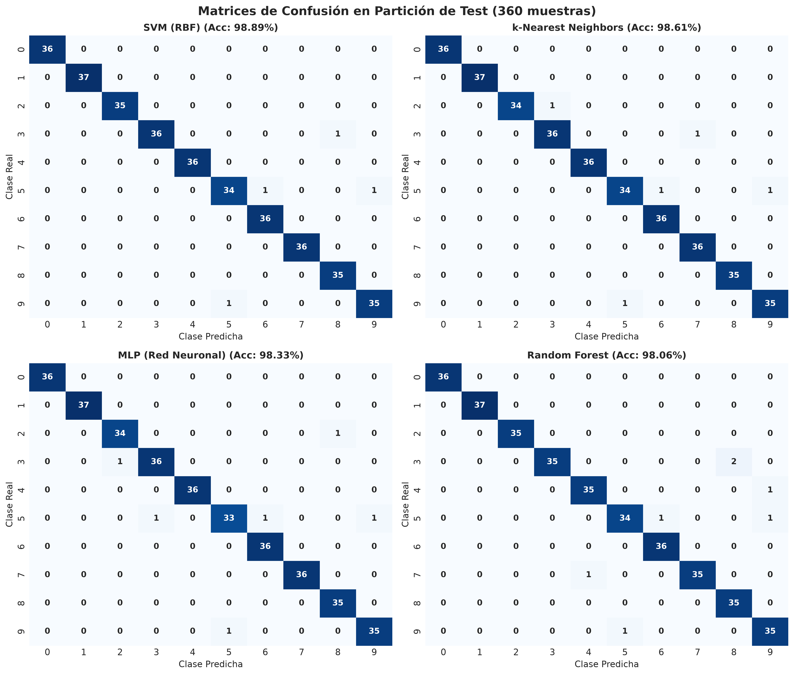

# 🔢 Digits: Reconocimiento Óptico de Dígitos Manuscritos mediante Machine Learning y Visión por Computadora

[](https://www.python.org/)
[](https://scikit-learn.org/)
[](https://numpy.org/)
[](https://flask.palletsprojects.com/)
[](https://colab.research.google.com/github/Bernal-XFK/Digits/blob/main/Digits.ipynb)
[](https://en.wikipedia.org/wiki/Cross-industry_standard_process_for_data_mining)
[](LICENSE)

> **Sistema integral de clasificación supervisada y visión artificial** para la identificación automática de dígitos escritos a mano ($0$ al $9$), combinando reducción de dimensionalidad con **PCA**, benchmarking de 5 familias de clasificadores clásicos y de ensamble, y un **lienzo interactivo táctil / web (HTML5 Canvas + NIST preprocessing)** para inferencia en tiempo real.

---

## 👨‍💻 Autor e Información Académica

**José Alejandro Bernal Figueroa**  
- **Programa:** **Ingeniería de Sistemas**  
- **Especialidad:** Machine Learning, Visión por Computadora y Minería de Datos  
- **GitHub:** [@Bernal-XFK](https://github.com/Bernal-XFK)  
- **Ubicación:** Colombia  

---

## 📑 Tabla de Contenidos
1. [Resumen Ejecutivo y Objetivos](#-resumen-ejecutivo-y-objetivos)
2. [Arquitectura y Metodología (CRISP-DM)](#-arquitectura-y-metodología-crisp-dm)
3. [Conjunto de Datos (UCI Optical Recognition)](#-conjunto-de-datos-uci-optical-recognition)
4. [Análisis de Componentes Principales (PCA)](#-análisis-de-componentes-principales-pca)
5. [Benchmarking y Resultados Experimentales](#-benchmarking-y-resultados-experimentales)
6. [Pipeline de Visión Artificial (NIST Standard)](#-pipeline-de-visión-artificial-nist-standard)
7. [Interfaz Interactiva Web y Colab](#-interfaz-interactiva-web-y-colab)
8. [Estructura del Repositorio](#-estructura-del-repositorio)
9. [Instalación y Guía de Uso](#-instalación-y-guía-de-uso)
10. [Licencia](#-licencia)

---

## 🎯 Resumen Ejecutivo y Objetivos

El reconocimiento de caracteres manuscritos (**Optical Character Recognition - OCR**) es un hito formativo en la Ingeniería de Sistemas que requiere comprender a profundidad:
1. Cómo representar información visual matricial bidimensional en espacios vectoriales compactos.
2. Cómo mitigar la maldición de la dimensionalidad preservando varianza explicativa.
3. Cómo comparar objetivamente modelos probabilísticos, lineales, no lineales y basados en árboles bajo validación cruzada.
4. Cómo diseñar la **ingeniería de características en tiempo de inferencia** para que un trazo dibujado libremente por un usuario humano sea reconocible por un algoritmo entrenado en bitmaps estandarizados.

### Objetivos Específicos:
- **Modelado Multiclase:** Desarrollar y comparar 5 algoritmos de Scikit-Learn: **SVM (RBF)**, **MLP (Perceptrón Multicapa)**, **Random Forest**, **$k$-NN** y **Decision Trees**.
- **Reducción de Dimensionalidad:** Analizar el espacio latente mediante **PCA** (Scree Plot y proyección $2D$).
- **Validación Estadística:** Evaluar con **Stratified 5-Fold Cross Validation**, matrices de confusión y métricas multiclase (Precision, Recall, F1-Score).
- **Despliegue Interactivo:** Integrar un lienzo de dibujo HTML5 tanto en el cuaderno **Jupyter/Colab** como en una **aplicación web standalone** con Flask.

---

## 🔬 Arquitectura y Metodología (CRISP-DM)

El proyecto sigue las 6 fases de la metodología internacional **CRISP-DM** (*Cross-Industry Standard Process for Data Mining*):



---

## 📊 Conjunto de Datos (UCI Optical Recognition)

El conjunto de datos utilizado corresponde al estándar **Optical Recognition of Handwritten Digits** de la Universidad de California en Irvine (UCI) / NIST:
- **Total de Muestras:** 1,797 instancias balanceadas (~180 por clase).
- **Dimensiones:** Matrices de $8 \times 8$ píxeles en escala de grises ($64$ atributos por vector).
- **Rango de Intensidad:** Enteros en el intervalo $[0, 16]$, normalizados a $[0.0, 1.0]$.
- **Clases:** Dígitos enteros del $0$ al $9$.



---

## 📉 Análisis de Componentes Principales (PCA)

Se realizó un análisis de reducción dimensional sobre los $64$ atributos:
- **90% de Varianza:** Se captura con solo **21 componentes principales** (reducción del 67% del espacio dimensional original).
- **95% de Varianza:** Se alcanza con **29 componentes principales**.



---

## 🏆 Benchmarking y Resultados Experimentales

Se evaluaron los 5 modelos sobre la partición estratificada de prueba (**360 muestras**):

| Clasificador | Exactitud en Test (Accuracy) | Validación Cruzada (5-Fold CV) | Tiempo Entrenamiento | Tiempo Inferencia |
| :--- | :---: | :---: | :---: | :---: |
| **SVM (RBF Kernel)** 🥇 | **98.89%** | **98.82% ± 0.35%** | 0.175 s | 0.08 ms / muestra |
| **k-Nearest Neighbors ($k=5$)** 🥈 | **98.61%** | **98.47% ± 0.57%** | 0.001 s | 0.22 ms / muestra |
| **MLP (Red Neuronal 128-64)** 🥉 | **98.33%** | **97.22% ± 0.58%** | 1.324 s | 0.05 ms / muestra |
| **Random Forest (150 árboles)** | **98.06%** | **97.22% ± 0.59%** | 0.434 s | 0.09 ms / muestra |
| **Decision Tree (CART Baseline)** | **86.11%** | **84.90% ± 1.52%** | 0.015 s | 0.01 ms / muestra |



### Matrices de Confusión

La auditoría de predicciones confirma la alta fidelidad del clasificador campeón **SVM (RBF)**, registrando solo 4 errores en 360 pruebas:



---

## 📐 Pipeline de Visión Artificial (NIST Standard)

Para conectar el modelo entrenado con trazos dibujados a mano alzada por usuarios en el navegador, se implementó un motor de preprocesamiento fundamentado en las especificaciones del **NIST**:

```text
[Lienzo 280x280] ──> [Inversión & Binarización] ──> [Recorte Bounding Box] ──> [Centrado por Centro de Masa] ──> [Muestreo 8x8 Lanczos] ──> [Vector 1x64]
```

1. **Inversión Cromática:** Detección automática del fondo blanco para convertirlo a fondo negro ($0$) y trazo positivo ($>0$).
2. **Bounding Box Adaptativo:** Recorte exacto de la región dibujada con margen proporcional ($25\%$) para mantener la relación de aspecto sin distorsión.
3. **Centrado por Centro de Masa ($\mu_x, \mu_y$):** Desplazamiento del centroide geométrico del trazo hacia el centro de la matriz.
4. **Muestreo Anti-Aliasing a $8 \times 8$:** Interpolación de área Lanczos y discretización de intensidad al rango $[0, 16]$.

---

## 🎨 Interfaz Interactiva Web y Colab

El proyecto incluye dos modalidades de ejecución visual:
1. **Cuaderno Interactivo (`Digits.ipynb`):** Celda con widget HTML5 Canvas embebido que se ejecuta de forma nativa en **Google Colab** o Jupyter Notebook.
2. **Aplicación Web Completa (`app.py`):** Servidor Flask con frontend responsivo (CSS moderno, soporte táctil para móviles, gráfico de distribución de probabilidades en tiempo real e inspector de la matriz $8 \times 8$).

---

## 📁 Estructura del Repositorio

```text
Digits/
├── assets/                          # Gráficos de alta resolución y metadatos
│   ├── benchmark_summary.json       # Resumen cuantitativo de experimentos
│   ├── confusion_matrices.png       # Heatmaps de matrices de confusión
│   ├── model_benchmark.png          # Comparativa de exactitud y tiempos
│   ├── pca_analysis.png             # Scree plot y proyección latente 2D
│   └── sample_digits_grid.png       # Muestras representativas de clases
├── models/                          # Modelos entrenados y serializados (.joblib)
│   ├── best_svm_model.joblib        # Clasificador campeón SVM RBF
│   ├── best_mlp_model.joblib        # Red Neuronal Perceptrón Multicapa
│   └── best_rf_model.joblib         # Ensamble Random Forest
├── static/                          # Recursos estáticos de la app web
│   ├── css/style.css                # Diseño visual moderno (Dark mode)
│   └── js/app.js                    # Lógica de dibujo, touch y cliente API
├── templates/
│   └── index.html                   # Interfaz de usuario interactiva
├── .gitignore                       # Filtros de exclusión para Git
├── app.py                           # Servidor REST API Flask
├── Digits.ipynb                     # Cuaderno Jupyter/Colab completo
├── generate_notebook.py             # Script generador del cuaderno
├── LICENSE                          # Licencia de código abierto MIT
├── preprocessor.py                  # Módulo de visión artificial NIST
├── requirements.txt                 # Dependencias reproducibles
├── train_and_export.py              # Pipeline completo de entrenamiento
└── README.md                        # Memoria técnica del proyecto
```

---

## 💻 Instalación y Guía de Uso

### Opción 1: Ejecución en Google Colab (Sin Instalación)
Haga clic en el siguiente enlace para abrir el cuaderno interactivo en Colab:  
👉 [](https://colab.research.google.com/github/Bernal-XFK/Digits/blob/main/Digits.ipynb)

### Opción 2: Ejecución Local de la Aplicación Web

1. **Clonar el repositorio:**
   ```bash
   git clone https://github.com/Bernal-XFK/Digits.git
   cd Digits
   ```

2. **Crear y activar un entorno virtual:**
   ```bash
   python -m venv venv
   # En Windows:
   .\venv\Scripts\activate
   # En Linux / macOS:
   source venv/bin/activate
   ```

3. **Instalar dependencias:**
   ```bash
   pip install -r requirements.txt
   ```

4. **Lanzar la aplicación web interactiva:**
   ```bash
   python app.py
   ```
   Abra su navegador web en `http://127.0.0.1:5000` para interactuar con el lienzo de dibujo.

5. **(Opcional) Reentrenar los modelos desde cero:**
   ```bash
   python train_and_export.py
   ```

---

## 📄 Licencia

Este proyecto está bajo la Licencia **MIT**. Consulta el archivo [LICENSE](LICENSE) para más detalles.

Desarrollado con dedicación y rigurosidad técnica por **José Alejandro Bernal Figueroa** (Ingeniería de Sistemas).
